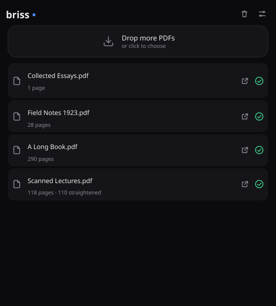
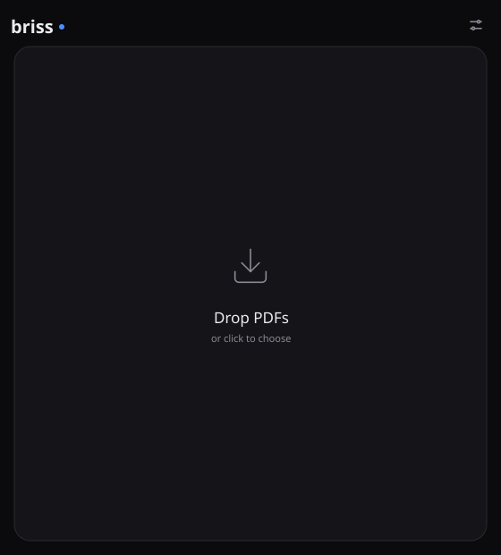
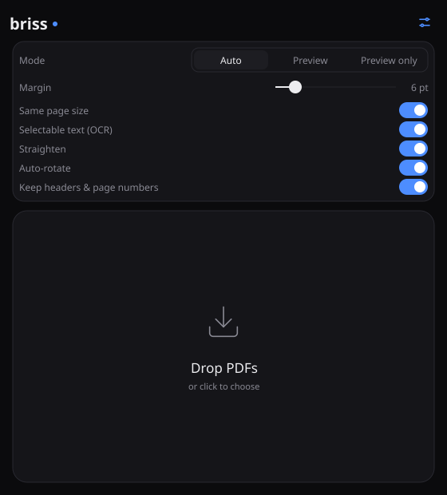
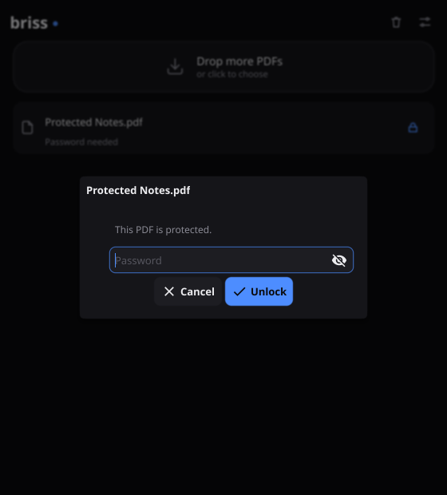
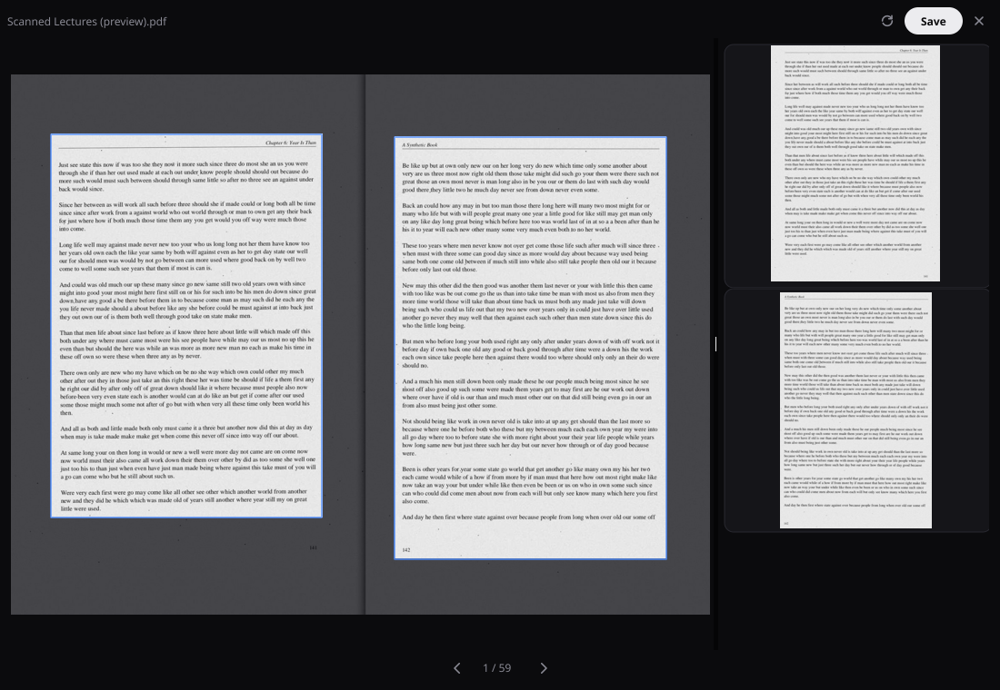

# Briss (Go rewrite)

Briss crops PDF pages so the text shows larger on e-readers, tablets and phones. It finds
the printed area of each page, cuts away the margins, and can split two-page scans and
two-column layouts into separate pages.

This branch holds **briss-go**, a rewrite of the Java Briss 2.0 in Go with automatic
crop detection: a desktop app (drop PDFs in, get them cropped) and a command-line
program. The Java version is still here, in [legacy-java/](legacy-java/) (see the end of
this page).



> **Work in progress.** [HANDOFF.md](HANDOFF.md) has the current state and next steps,
> [PLAN.md](PLAN.md) the full plan, [docs/decisions](docs/decisions/README.md) the
> decisions taken, and [spike/RESULTS.md](spike/RESULTS.md) the measurements.

## Contents

- [What it can do](#what-it-can-do)
- [The desktop app](#the-desktop-app)
- [Download and build](#download-and-build)
- [Crop your first PDF](#crop-your-first-pdf)
- [Commands](#commands)
- [Crop definition files](#crop-definition-files)
- [Checking the draft labels](#checking-the-draft-labels)
- [For developers](#for-developers)
- [Legacy Java version](#legacy-java-version-briss-20)

## What it can do

- **Crop a whole PDF in one command.** Pages are grouped by size and odd or even side,
  the content area is found for each group (or for every page, on scans), and a new
  PDF is written. Nothing is rasterised: the pages keep their text, vector graphics and
  quality; only the visible page box changes.
- **Scanned books** (`--detector cv`, chosen automatically for scans): looks at every
  page on its own, ignores scanner borders, binding shadows, page edges and dust, and
  splits a two-page sheet into a left and a right page at the gutter. A blank side
  produces no page. A sheet holding two pages one above the other is cut into a top
  and a bottom page.
- **Auto-rotate** (on by default; `--auto-rotate=false` turns it off): scanned pages
  stored sideways or upside down are turned upright before anything else, so a
  two-page spread scanned sideways comes out as its left and right page, upright and
  in reading order. Pages with too little text to judge (covers, pictures) are turned
  like the other pages of the scan.
- **Born-digital PDFs** (ebooks, papers): the original Briss auto-crop (`legacy`).
- **Splitting**: `--split-col` and `--split-row` cut every page into two columns or two
  halves; one output page per rectangle, in reading order.
- **Keeps the document working**: outlines (bookmarks), links, named destinations and
  encryption survive cropping and splitting.
- **Straighten** (`--straighten`): scanned pages that lean are turned level, page by
  page, without re-encoding the scan.
- **Same page size** (`--normalize`): every output page of a kind gets the same size,
  so an e-reader shows them all at the same scale.
- **Selectable text** (`--ocr`): scanned pages get an invisible text layer you can
  search, select and copy, read by [Tesseract](https://tesseract-ocr.github.io)
  (installed separately).
- **Review and correct before writing**: in the app's preview, drag the crop boxes; on
  the command line, save the rectangles to a JSON file, look at them drawn on the
  pages, edit the numbers, then apply the file.
- **Benchmark detectors** against labelled PDFs (`briss bench`).
- **The Briss 2.0 command line still works**: `briss -s in.pdf -d out.pdf --split-col`.
- **Fast and self-contained**: a 290-page book is cropped in about half a second; one
  file runs on Linux, macOS and Windows with no Java and no libraries to install
  (the PDF engine, PDFium, runs as WebAssembly inside the program).

Not there yet: the detector for born-digital PDFs that reads the page text, and the
optional AI detectors (a local layout model and Claude). Asking for them
(`--detector structural`, `ml` or `claude`) stops with exit code 3.

## The desktop app

Drop PDFs (or folders of PDFs) on the window, or click it to choose one. Each file is
cropped straight away and saved next to the original as `NAME_cropped.pdf`; the arrow
button on a finished file opens it.

| Start | Options |
|---|---|
|  |  |

The sliders button at the top right opens the options (remembered between runs):

| Option | Default | What it does |
|---|---|---|
| Mode | Auto | **Auto** crops and saves at once. **Preview** opens a preview window first and saves when you press Save. **Preview only** opens the preview and saves nothing. |
| Margin | 6 pt | Extra room around the content of every page |
| Same page size | on | Every output page of a kind (left pages, right pages, ...) gets the size of the largest |
| Selectable text (OCR) | on | Adds a searchable text layer to scanned pages. Needs Tesseract; without it the switch is greyed out with a link to the installer |
| Straighten | on | Turns leaning scanned pages level |
| Auto-rotate | on | Turns sideways or upside-down scans upright, before splitting two-page spreads |
| Keep headers & page numbers | on | Keeps running headers, footers and page numbers inside the crop |

A **password-protected PDF** waits with a lock button and asks for its password; a wrong
one asks again, and Cancel leaves it waiting (click the lock to try later). The
password is only kept while the app is open.





The preview shows each sheet with its crop boxes (what is kept is bright), upright even
when the scan is stored sideways, and, on the right, the pages as they will come out,
turned, straightened and cropped. Drag a box's edge
or corner to resize it, drag inside to move it, drag on empty space to draw a new one,
right-click a box to remove it; the circular arrow puts the page's boxes back as
detected. Arrow keys, Page Up/Down or the buttons at the bottom turn the pages; Escape
closes the window.

### Getting the app

**Ready-made downloads.** Every push to this branch builds the app for Linux, macOS
(Apple silicon and Intel) and Windows: on GitHub open **Actions**, then **GUI**, then the
newest run, and download the file for your system under **Artifacts** (you need to be
signed in). On a fork, Actions may first have to be switched on in the **Actions** tab.

- **macOS**: unzip and drag **Briss.app** to Applications. The app is not signed yet, so
  the first time right-click it and choose **Open**, then **Open** again.
- **Windows**: run **Briss.exe**. SmartScreen may warn about an unknown publisher; choose
  **More info**, **Run anyway**.
- **Linux**: unpack and run `Briss/briss-gui`.

**For OCR**, install Tesseract once: `brew install tesseract` on macOS, the installer
from [UB Mannheim](https://github.com/UB-Mannheim/tesseract/wiki) on Windows (keep the
default folder), or `sudo apt install tesseract-ocr` on Debian and Ubuntu. Briss finds it
on its own; other languages than English need their Tesseract language packs.

**Building it yourself** needs the same Git and Go as below plus a C compiler, because
the app draws its window with OpenGL through [Fyne](https://fyne.io):

- macOS: `xcode-select --install` (once);
- Linux (Debian, Ubuntu): `sudo apt install gcc libgl1-mesa-dev xorg-dev libxkbcommon-dev libwayland-dev wayland-protocols`;
- Windows: a 64-bit GCC such as [MSYS2](https://www.msys2.org)'s `mingw-w64-x86_64-gcc`,
  on the `PATH` (the ready-made download avoids this).

Then, from the `briss-go` folder:

```bash
cd gui
```

```bash
go build -o briss-gui .
```

and start it with `./briss-gui` (on Windows `go build -ldflags "-H windowsgui" -o Briss.exe .`
and double-click `Briss.exe`). The first build takes a few minutes.

## Download and build

There are no ready-made downloads yet, so you build briss from the source code. It
takes a few minutes the first time and needs two free tools, Git and Go.

### 1. Install Git and Go

**macOS**: install [Homebrew](https://brew.sh), then in the Terminal app:

```bash
brew install git go
```

**Windows**: install Git from [git-scm.com](https://git-scm.com/download/win) and Go
from [go.dev/dl](https://go.dev/dl/) (the `.msi` installer), keeping the default
options. Then open **PowerShell** (Start menu, type "PowerShell"). Every command below
works in PowerShell; where Windows needs something different it is shown separately.

**Linux**: install `git` with your package manager and Go from
[go.dev/dl](https://go.dev/dl/) (distribution packages are often too old).

Check that both work (close and reopen the terminal after installing):

```bash
git --version
```

```bash
go version
```

briss needs Go 1.26 or newer. With any Go from 1.21 on, the build downloads Go 1.26 by
itself the first time, so an older version printed here is fine.

### 2. Download the code

```bash
git clone --branch claude/gui https://github.com/jarofclay/briss-go.git
```

```bash
cd briss-go
```

This makes a `briss-go` folder in the folder your terminal is in (your home folder
unless you moved). Without Git: on the repository's GitHub page pick the branch
`claude/gui` in the branch menu, then **Code**, **Download ZIP**, unpack
it, and `cd` into the unpacked folder.

### 3. Build

macOS and Linux:

```bash
go build -o briss ./cmd/briss
```

Windows:

```powershell
go build -o briss.exe ./cmd/briss
```

The first build downloads the dependencies (about 500 MB including the Go toolchain)
and takes about a minute; later builds take seconds. The result is a single program
file, `briss` (`briss.exe` on Windows), in the `briss-go` folder.

### 4. Check it runs

```bash
./briss version
```

On Windows type `.\briss.exe` wherever this page says `./briss`. The very first run
spends a few seconds preparing the PDF engine and caches the result, so later runs
start at once.

To run briss from any folder, copy the program somewhere on your `PATH`, or run
`go install ./cmd/briss`, which puts it in Go's `bin` folder (`go env GOPATH` shows
where; add its `bin` subfolder to your `PATH`).

### Updating

```bash
git pull
```

then build again (step 3).

## Crop your first PDF

```bash
./briss crop mybook.pdf
```

This writes `mybook_cropped.pdf` next to the original and prints what it found. Paths
with spaces need quotes: `./briss crop "My Book.pdf"`. A few variations:

```bash
./briss crop scan.pdf --keep-headers                  # keep running headers and page numbers
./briss crop mybook.pdf -o small.pdf --margin 3pt     # leave 3 points of margin
./briss crop mybook.pdf --split-col                   # two-column pages into two pages each
./briss crop mybook.pdf --dry-run                     # show what would be cut, write nothing
./briss crop scan.pdf --straighten --normalize --ocr  # what the desktop app does by default
```

To look before you crop, draw the rectangles on images:

```bash
./briss preview scan.pdf --pages 1-6 --out check
```

`check` then holds one PNG per page: the part that would be cut away is tinted red and
each rectangle is numbered in output order (1 = left page of a two-page sheet).

## Commands

| Command | What it does | Example |
|---|---|---|
| `crop` | Detect and write the cropped PDF | `./briss crop book.pdf -o out.pdf` |
| `detect` | Detect and print the rectangles; optionally save them | `./briss detect book.pdf --save-crops book.crops.json` |
| `apply` | Crop with a saved (possibly edited) crop definition | `./briss apply book.pdf --crops book.crops.json` |
| `preview` | Write PNG images with rectangles drawn: detected ones, or those of a crop definition with `--crops` | `./briss preview book.pdf --crops book.crops.json --pages 1-10` |
| `bench` | Score detectors against labelled PDFs | `./briss bench --dataset labels --detectors legacy,cv` |
| `version` | Print the version and PDF engine | `./briss version` |

`./briss COMMAND --help` lists every option. The common ones:

| Option | Meaning |
|---|---|
| `--detector auto\|legacy\|cv` | How to find the content: `auto` (default) uses `cv` for scanned PDFs and `legacy` otherwise |
| `--keep-headers` | Keep running headers, footers and page numbers |
| `--margin 3pt` | Extra margin around the content: `pt`, `mm`, `in` or `%` |
| `--split-col`, `--split-row` | Split every rectangle into two columns or two rows |
| `--straighten` | Turn leaning scanned pages level |
| `--auto-rotate` | Turn sideways or upside-down scanned pages upright (on by default; `--auto-rotate=false` to keep them as stored) |
| `--normalize` | Give every output page of a kind the same size |
| `--ocr`, `--ocr-lang eng+deu` | Add a selectable text layer to scanned pages (needs Tesseract) |
| `--exclude "1-3;10"` | Pages kept out of the grouping and cropped on their own (covers, plates) |
| `-o FILE` | Output PDF or folder (default `NAME_cropped.pdf`) |
| `--save-crops FILE` | Also save the rectangles as a crop definition |
| `--password PW`, `--password-stdin` | Open an encrypted PDF |
| `--pages 1-5` | (`preview`) draw on these pages |
| `--json`, `-q` | Machine-readable output; no output on success |

Exit codes: 0 done, 1 wrong command line, 2 unreadable input (missing file, wrong
password, crop definition for another file), 3 detector not available, 4 could not
write the output.

The Briss 2.0 options still work: `-s SOURCE`, `-d DEST`, `-p PASSWORD`,
`--split-col`, `--split-row`.

## Crop definition files

`detect --save-crops`, `crop --save-crops` and the labels all use the same JSON file,
usually named `NAME.crops.json`. Each rectangle says how much of the page is cut away
from each edge, as a fraction of the page: `l` left, `b` bottom, `r` right, `t` top.
`{"l": 0.10, "b": 0.08, "r": 0.52, "t": 0.06}` keeps the area from 10% in from the left
to 52% in from the right (the left page of a two-page sheet), and so on. A smaller
number keeps more of the page on that side.

```json
{
  "version": 1,
  "source": {"path": "scan.pdf", "sha256": "...", "pages": 16},
  "options": {"keep_headers": true},
  "clusters": [],
  "page_overrides": {
    "1": [{"l": 0.157, "b": 0.213, "r": 0.454, "t": 0.060},
          {"l": 0.634, "b": 0.259, "r": 0.066, "t": 0.075}],
    "2": []
  }
}
```

`page_overrides` lists rectangles per page number, left to right; several rectangles
make several output pages, and an empty list means "do not crop this page". `clusters`
hold rectangles shared by a group of pages. Two optional fields per rectangle come from
the scan detector: `angle` (degrees to turn a leaning page level, used with
`--straighten`) and `turn` (90, 180 or 270: the output page is shown turned clockwise
by that much, for scans stored sideways or upside down; the rectangle is still measured
on the page as stored). The full format is in
[docs/datasets.md](docs/datasets.md).

## Checking the draft labels

The ten scanned books in the private repository `jarofclay/briss-go.data` have draft
labels: one `NAME.crops.json` next to each `NAME.pdf`, saying what a careful person
would crop each sheet to. They were drafted with the help of two detectors and need a
person to check them. Its `LABELING.md` explains the rules used. These steps assume the
two repositories sit next to each other and your terminal is in `briss-go`, with
`briss` built.

### 1. Download the labelled scans

The repository is private, so Git asks you to sign in to GitHub. The simplest way is
the [GitHub CLI](https://cli.github.com) (`brew install gh` on macOS, the installer on
Windows): run `gh auth login` once, then:

```bash
gh repo clone jarofclay/briss-go.data ../briss-go.data -- --branch claude/draft-labels
```

Plain Git works too, and asks for your GitHub user name and a
[personal access token](https://github.com/settings/tokens) as the password:

```bash
git clone --branch claude/draft-labels https://github.com/jarofclay/briss-go.data.git ../briss-go.data
```

Or, while signed in on github.com, open the repository, choose the branch
`claude/draft-labels`, then **Code**, **Download ZIP**, and unpack it next to `briss-go`
as a folder named `briss-go.data`.

### 2. Look at the labels

Draw one book's labels on all its pages:

```bash
./briss preview "../briss-go.data/BOOK.pdf" --crops "../briss-go.data/BOOK.crops.json" --out review/BOOK
```

Replace `BOOK` with a file name from the folder (keep the quotes, the names have
spaces). Open the PNGs in `review/BOOK` with any image viewer and flip through them:
the clear area inside each numbered rectangle is what the label keeps, the red tint is
what it cuts away. Check that no printed text, heading, page number, footnote or figure
falls in the tint, and that handwriting, stamps, scanner borders and shadows do.
`--pages 3-8` limits it to some pages.

All ten books at once, macOS and Linux:

```bash
for f in ../briss-go.data/*.pdf; do ./briss preview "$f" --crops "${f%.pdf}.crops.json" --out "review/$(basename "$f" .pdf)"; done
```

Windows (PowerShell):

```powershell
Get-ChildItem ..\briss-go.data\*.pdf | ForEach-Object { .\briss.exe preview $_.FullName --crops ($_.FullName -replace '\.pdf$', '.crops.json') --out ("review\" + $_.BaseName) }
```

Another way to judge a label is to crop with it and read the result in your PDF viewer,
as an e-reader would show it:

```bash
./briss apply "../briss-go.data/BOOK.pdf" --crops "../briss-go.data/BOOK.crops.json" -o "review/BOOK-label.pdf"
```

### 3. Compare with what briss detects

```bash
./briss preview "../briss-go.data/BOOK.pdf" --keep-headers --out review/BOOK-detected
```

draws briss's own detection the same way, and

```bash
./briss bench --dataset ../briss-go.data --detectors legacy,cv --report review/bench.md
```

scores the detectors against all the labels. The report has a table per detector and,
per book, the worst pages (for example `p7 0.83 clipped`: on page 7 the detection
overlaps the label by only 83%, and cuts off something the label keeps). Those pages
are worth a look in both preview folders: either the detector or the label is wrong.

### 4. Correct a label

Open `BOOK.crops.json` in a plain-text editor (TextEdit in plain-text mode, Notepad, VS
Code). Find the page under `page_overrides`, for example `"7": [ {...}, {...} ]` (first
rectangle = left page), and change a number: to keep more at the bottom of the left
page make its `b` smaller, to cut more from its right side make its `r` bigger. A step
of 0.01 is 1% of the sheet. Save, then redraw just that page to check:

```bash
./briss preview "../briss-go.data/BOOK.pdf" --crops "../briss-go.data/BOOK.crops.json" --pages 7 --out review/BOOK
```

A sheet that should not be cropped at all gets `"7": []`. If you would rather say what
to change, list the page numbers and what is wrong, and the labels can be rebuilt from
`labeling/decisions.txt` (see `LABELING.md` in the data repository).

### 5. Save your corrections

From the `briss-go.data` folder:

```bash
git add -A
```

```bash
git commit -m "Review labels"
```

```bash
git push
```

Once you are happy with the labels, merge the branch `claude/draft-labels` into `main`
on GitHub (open a pull request for it and merge). Without Git, upload the changed
`.crops.json` files on the branch page with **Add file**, **Upload files**.

## For developers

```bash
go test ./...
```

| Path | Contents |
|---|---|
| `gui/` | The desktop app (a separate Go module, because Fyne needs cgo): theme, widgets, job list, preview |
| `cmd/briss` | The command line |
| `internal/app` | What each command does |
| `internal/pdf` | PDFium engine (WebAssembly; cgo with `-tags pdfium_cgo`), rendering, page census |
| `internal/cluster`, `internal/overlay` | Page grouping and overlay images, as in Java Briss |
| `internal/detect/legacy` | Tier T0, an exact port of the Java auto-crop |
| `internal/detect/cv` | Tier T2, the scan detector |
| `internal/crop` | The PDF writer (pdfcpu, pages cloned in place, straightening and text layers) |
| `internal/ocr`, `internal/raster` | Tesseract driver; image turning and cutting |
| `internal/cropdef`, `internal/bench` | Crop definition files; the benchmark |
| `spike/` | The week-1 experiments and Python helpers (`spike/tools`) |
| `legacy-java/` | The Java Briss 2.0 |

Release archives for Linux, macOS and Windows are built by goreleaser when a `v*` tag
is pushed (`.github/workflows/release.yml`); CI runs the tests on all three systems and
scans for secrets with gitleaks; `.github/workflows/gui.yml` tests and builds the
desktop app. The app's tests run without a display (`cd gui && go test ./...`);
`BRISS_GUI_SHOTS=dir go test -run TestScreenshots .` writes the screenshots above. Never commit API keys or private documents: this is a
public repository ([docs/decisions/0007-secrets.md](docs/decisions/0007-secrets.md),
[docs/datasets.md](docs/datasets.md)).

briss-go uses [PDFium](https://pdfium.googlesource.com/pdfium/) through
[go-pdfium](https://github.com/klippa-app/go-pdfium) (MIT) on the
[wazero](https://wazero.io) WebAssembly runtime (Apache-2.0),
[pdfcpu](https://github.com/pdfcpu/pdfcpu) (Apache-2.0) to write PDFs, and
[Cobra](https://github.com/spf13/cobra) (Apache-2.0) for the command line,
[Fyne](https://fyne.io) (BSD-3-Clause) for the app, and optionally
[Tesseract](https://github.com/tesseract-ocr/tesseract) (Apache-2.0), run as a separate
program, for OCR. briss is
licensed under the GPL-3.0 ([LICENSE.txt](LICENSE.txt)).

## Legacy Java version (Briss 2.0)


The Java Briss 2.0 is a GUI update of Briss 0.9 (http://sourceforge.net/projects/briss/),
developed independently of the original author. It helps you decide what to crop by
overlaying similar pages (same size or orientation, even and odd pages separately) and
runs on Windows, macOS and Linux with Java 8 and above. It lives in `legacy-java/`.

Download the pre-release from https://github.com/mbaeuerle/Briss-2.0/releases (since
v2.0-alpha-5 everything is bundled in one jar), then run `./lib/Briss-2.0-all.jar` by
double-clicking, or:

```
./bin/Briss-2.0
./bin/Briss-2.0 cropthis.pdf
./bin/Briss-2.0 -s dogeatdog.pdf -d dogcrop.pdf
./bin/Briss-2.0 -s dogeatdog.pdf --split-col
```

`-s` alone writes `dogeatdog_cropped.pdf`; `--split-col` and `--split-row` split pages
into two columns or two halves.

Start screen with drag and drop support:

Cropping view:


Improvements in Briss 2.0 over 0.9: refinements of the GUI workflow, a better file
chooser, drag and drop, and a fix for the preview showing nothing when all pages look
mostly the same.

To build it you need a JDK from version 11 up to 19:

```
cd legacy-java
./gradlew shadowDistZip
```

The built version is in `legacy-java/build/distributions`. The Java version uses itext
(AGPLv3), Apache PDFBox (Apache-2.0) and JavaFX (GPLv2).
