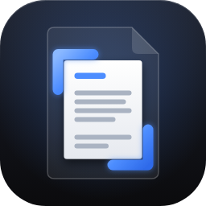

# The Briss logo

A faint page, with the part that survives the crop lifted out in front of it and
framed by two blue crop corners, on the app's dark tile. The blue is the app's
accent colour (`colAccent` in `gui/theme.go`).



| File | Used for |
|---|---|
| `svg.py` | Writes the four SVG drawings (full and simplified for 16 to 32 pixels; flat tile and Apple's icon grid) |
| `render.js` | Renders them to `png/briss-<size>.png` and `Briss.iconset/` with Chromium (Playwright) |
| `winres.py` | Packs the PNGs into the Windows icon resources `cmd/briss/rsrc_windows_*.syso` and `gui/rsrc_windows_*.syso`, which `go build` links in by itself |
| `check_winres.py` | Checks that a built `.exe` carries the icon (run by the GUI and release workflows) |
| `png/` | Windows, the Linux download (`briss.png`), the README; `briss-512.png` is also `gui/icon.png`, the window and Dock icon |
| `Briss.iconset/` | The macOS app: `.github/workflows/gui.yml` turns it into `Briss.icns` with `iconutil` |

To change the logo, edit `svg.py`, then run from this folder:

```bash
python3 svg.py && node render.js && python3 winres.py && cp png/briss-512.png ../../gui/icon.png
```

`render.js` needs Node and Playwright with Chromium; the other two scripts use only
Python's standard library.
